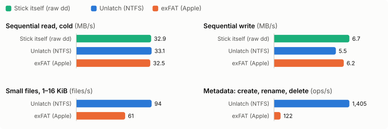

<p align="center">
  <picture>
    <source media="(prefers-color-scheme: dark)" srcset="docs/brand/wordmark-dark.svg">
    
  </picture>
</p>

# Unlatch

Unlatch lets your Mac write to NTFS disks: Windows-formatted USB drives, external SSDs and internal partitions. It runs [libntfs-3g](https://github.com/tuxera/ntfs-3g) behind a small mount daemon on [macFUSE](https://macfuse.github.io), with a menu-bar app that mounts disks as you plug them in and a command-line tool, `unlatch`. It is free software under the GPL.

**Status: beta.** It is tested heavily on disk images (randomized model tests, fuzzing, Windows `chkdsk` of every kind of volume it writes; see [docs/test-matrix.md](docs/test-matrix.md)) and has been used on real disks, but it is new. Keep a backup of anything that matters on the disks you use it with.

## Requirements

| What | Why | Who installs it |
|---|---|---|
| A Mac with Apple Silicon (M1 or later) | Unlatch is built for arm64 only | – |
| macOS 27 or later | the macFUSE and system APIs Unlatch uses | – |
| [macFUSE](https://macfuse.github.io) 5.4 or later | Unlatch mounts disks through it. Its license does not allow bundling it, so it is installed separately | **Unlatch does it for you** (setup window, `unlatch setup`, or the Homebrew cask), from macFUSE's own releases |
| An administrator password | installing macFUSE and the disk helper | you, when macOS asks |

Everything else ships inside Unlatch: libntfs-3g (the NTFS engine) and swift-argument-parser are built into its programs, and the rest is part of macOS. Nothing else needs to be installed.

## Install

Pick one.

**Homebrew** (recommended; installs macFUSE too):

```sh
brew tap ramanan-bala/unlatch
brew trust --tap ramanan-bala/unlatch       # Homebrew 7 loads casks from other taps only once trusted
brew install --cask ramanan-bala/unlatch/unlatch
```

**DMG:** download `Unlatch-<version>.dmg` from [Releases](https://github.com/Ramanan-Bala/unlatch/releases), optionally check it (`shasum -a 256 -c SHA256SUMS`), open it and drag **Unlatch** to **Applications**. Unlatch installs macFUSE for you during setup.

**Command-line tools only** (no app; built from source, needs Xcode 27):

```sh
brew install --cask macfuse
brew tap ramanan-bala/unlatch
brew trust --tap ramanan-bala/unlatch
brew install ramanan-bala/unlatch/unlatch
unlatch setup
```

## One-time setup

The first time, Unlatch's setup window opens and checks each step; most of them it does for you. From a terminal, `unlatch setup` runs the same steps, and `unlatch doctor` checks them at any time.

1. **Open Unlatch.** It is not signed with an Apple Developer ID (the project has no paid Apple membership), so macOS asks first. In Applications, right-click **Unlatch** > **Open** > **Open**. If there is no Open button: System Settings > Privacy & Security > **Open Anyway**. Needed once per version. Do this before using `unlatch` in Terminal: until the app has been opened once, macOS stops its bundled programs without a message (`zsh: killed`).

2. **macFUSE.** In the setup window, click **Install macFUSE**. Unlatch downloads the latest release from macFUSE's GitHub page, checks it against the checksum macFUSE publishes, checks that the installer is signed by macFUSE's developer (Benjamin Fleischer, team 3T5GSNBU6W) and notarized by Apple, and then installs it. macOS asks for your password. If macFUSE is older than 5.5, the button says **Update macFUSE**. Homebrew users already have it.

3. **Turn on macFUSE's file system extension.** Unlatch mounts through macOS's own file system extension framework (FSKit), so there is no kernel extension to allow, no Recovery and no restart. Only you can switch it on, once:
   1. Click **Open Login Items & Extensions** in the setup window (or System Settings > **General** > **Login Items & Extensions**).
   2. Under Extensions, click the info button next to **File System Extensions**. If the switch is greyed out, choose to view the list **By Category**.
   3. Turn on **macFUSE**, then click **Done**. The self-test (step 5) confirms it.

4. **The helper, for real disks.** Disk images work without it. For USB drives and internal disks, click **Install…** in the setup window (or answer yes in `unlatch setup`); macOS asks for your password. Then click **Allow in Full Disk Access**: System Settings opens at Privacy & Security > **Full Disk Access**, and a Finder window shows **Unlatch Helper**. Drag it into the list and turn it on. Without it, macOS keeps the helper from opening removable disks.

   Why the helper and not the app? Disk devices can only be opened by root, so the small root helper opens them and hands them to Unlatch, which runs as you. macOS checks Full Disk Access for the program that opens the disk, which is the helper. In Login Items it appears under Unlatch.

5. **Self-test.** The setup window mounts a tiny built-in NTFS volume and reads it back. When it shows a green check, you are done. Optional: **Open Unlatch at login**, and **Copy install command** to put `unlatch` on your PATH (Homebrew does that already).

Check it all again any time from the menu bar: **Setup & Health…** opens the same window (its icon turns orange when something needs attention). From a terminal:

```sh
unlatch doctor
```

[docs/install.md](docs/install.md) has more detail, and [docs/troubleshooting.md](docs/troubleshooting.md) covers what to do when a step fails.

## Use

- **Plug in a disk.** Unlatch mounts NTFS disks in Finder, under `/Volumes`, read-write when Windows left them in a clean state. Settings choose which disks are mounted automatically, and the menu has per-disk choices.
- **Eject** from the menu, from Finder, or with `unlatch eject <disk>` before unplugging.
- **Read-only when it is not safe to write.** If Windows was hibernated, used Fast Startup, or did not finish writing, Unlatch mounts the disk read-only and says why. [docs/read-only.md](docs/read-only.md) explains each reason and the fix.
- **Command line:** `unlatch list`, `mount`, `unmount`, `eject`, `status`, `doctor`; see [docs/cli.md](docs/cli.md).

## What works

- Reading and writing files and folders of any size, sparse and compressed files, Unicode names (stored in Windows' normal form, NFC).
- Extended attributes, Finder tags and comments, kept as NTFS named streams, so no `._` files appear; Windows sees them as alternate data streams.
- Symlinks: links within the disk are native Windows symlinks that Windows follows; other links use the WSL format. Windows symlinks and junctions are readable. Hard links.
- Hidden files, and the Windows read-only attribute as a missing write permission.

## Limitations

- **Windows Fast Startup** keeps the disk "in use" when Windows only appears to shut down. Unlatch then mounts read-only. Turn Fast Startup off in Windows (Control Panel > Power Options > "Choose what the power buttons do"), or hold Shift while choosing Shut Down.
- **Windows name rules apply.** Names cannot contain `\ / : * ? " < > |`, end with a dot or space, or be a reserved name such as `CON` or `aux.txt`; the Mac reports "invalid argument" for those.
- **Encrypted (EFS) files** cannot be read or written; BitLocker volumes are not supported.
- **No journal replay.** Like ntfs-3g, Unlatch does not replay the NTFS journal. Always eject before unplugging; if a disk was pulled out mid-write, run `chkdsk` on Windows before relying on it.
- **Not indexed by Spotlight**, and not usable for Time Machine.
- Permissions: files belong to the user who mounted the disk; NTFS access lists are not mapped.
- Speed depends on the disk; see [Speed](#speed) below.

When something goes wrong: [docs/troubleshooting.md](docs/troubleshooting.md). Security issues: [SECURITY.md](SECURITY.md).

## Speed

On a real USB 2.0 stick (SanDisk Cruzer Blade 16 GB, Apple M2, Unlatch 1.0.0-beta.3), next to the stick's own speed and Apple's exFAT driver on the same stick:

<p align="center">
  <picture>
    <source media="(prefers-color-scheme: dark)" srcset="Bench/usb-dark.svg">
    
  </picture>
</p>

| | Stick itself (raw `dd`) | Unlatch (NTFS) | exFAT (Apple) |
|---|---|---|---|
| Sequential read, cold | 32.9 MB/s | 33.1 MB/s | 32.5 MB/s |
| Sequential write | 6.7 MB/s | 5.5 MB/s | 6.2 MB/s |
| Small files (1–16 KiB, create + delete) | | 94 files/s | 61 files/s |
| Metadata (create, rename, delete) | | 1,405 ops/s | 122 ops/s |

Reads run at the stick's full speed; sequential writes reach 82% of it (exFAT 93%); small files and metadata are faster than exFAT, helped by the engine's write-back cache for NTFS's small metadata writes. Median of 3 runs, 512 MiB files. On a fast SSD image, sequential copies run at about 1.5–2.7 GB/s ([docs/M0-gate.md](docs/M0-gate.md)). How these are measured: [Bench/README.md](Bench/README.md).

## Building

Xcode 27, [XcodeGen](https://github.com/yonaskolb/XcodeGen), Git LFS, and macFUSE (for its headers):

```sh
Scripts/bootstrap.sh                       # checks tools, builds libntfs-3g, generates Unlatch.xcodeproj
xcodebuild -scheme Unlatch build           # app, unlatch-fuse, helper, engine, test harness
swift build --package-path CLI             # the unlatch command
Scripts/release.sh --allow-dirty           # a local DMG in build/release/
```

[AGENTS.md](AGENTS.md) lists every build and test command; [docs/dev-setup.md](docs/dev-setup.md) covers macFUSE and logs.

## How it is built

- `Engine/`: a small C engine over libntfs-3g with one public header (`unlatch_engine.h`), a write-back page cache, and crash-leftover repair.
- `Fuse/`: `unlatch-fuse`, the mount daemon, on libfuse's low-level API.
- `Helper/`: a tiny privileged helper that only opens NTFS disk devices for the logged-in user and hands them to the daemon, which runs as you.
- `Shared/`, `CLI/`, `App/`: Swift: disk detection and mounting, the `unlatch` command, the menu-bar app.

The design and every decision behind it are in [docs/Unlatch-Implementation-Plan.md](docs/Unlatch-Implementation-Plan.md), [docs/DECISIONS.md](docs/DECISIONS.md) and [docs/PROGRESS.md](docs/PROGRESS.md).

## After 1.0

- A native FSKit module, once the project can sign one (needs a paid Apple Developer membership), replacing macFUSE.
- A repair assistant for disks that need `chkdsk`, and a format command (mkntfs).
- Engine replacement behind `unlatch_engine.h` if a better NTFS implementation becomes available.
- Localization.

## License

Unlatch is free software: GPL-3.0-or-later ([LICENSE](LICENSE)). It includes libntfs-3g (GPL-2.0-or-later) and uses swift-argument-parser (Apache-2.0); the app's Settings > About > Licenses and source has every notice and the source offer. macFUSE is separate software with its own license and is never included.

Contributions are welcome under the Developer Certificate of Origin; see [CONTRIBUTING.md](CONTRIBUTING.md).
